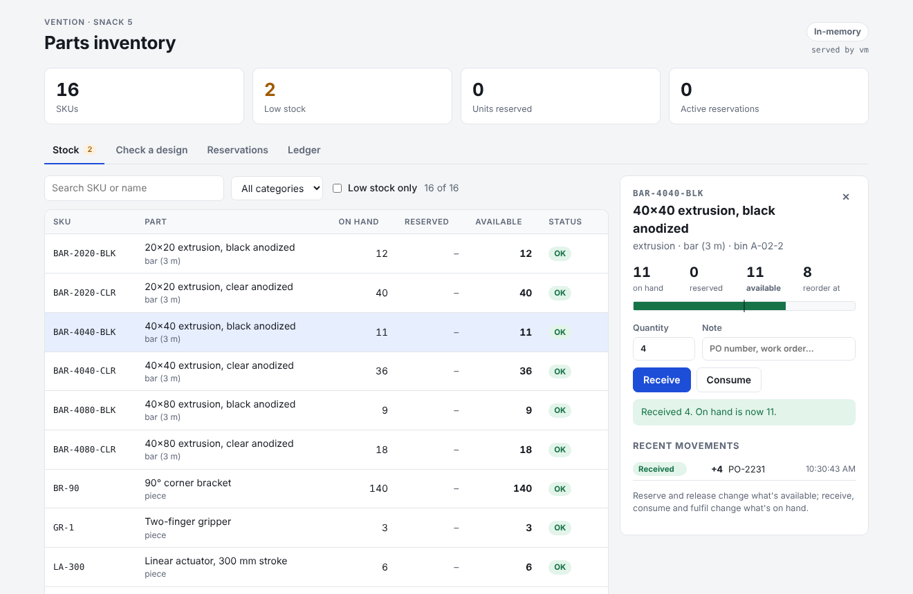
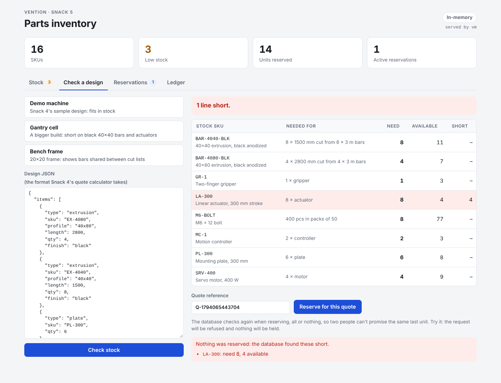

# Parts Inventory: PostgreSQL or MongoDB

**Stack:** Node.js 22 + TypeScript API, React 19 + Vite, PostgreSQL 17 **or** MongoDB 8, Docker Compose, Kubernetes
**Status:** Built

A stock system for the parts the other snacks use: aluminium extrusion bars, plates, fasteners,
motors, actuators, controllers. It answers "what do we have?", and "can we build this machine?":
paste a design in the same format Snack 4's quote calculator takes, and it works out the stock
the design needs (including how many 3 m bars the cut list needs), checks it against live stock,
and reserves it for the quote, all or nothing.

The same API runs on **either database**, chosen with one setting. Both implement one
repository interface and pass the same contract tests.

## Features

- [x] Stock list with search, category filter, and low-stock alerts (available at or below the reorder level)
- [x] Add new parts from the page (category, SKU, name, unit, bin, starting stock, reorder level); starting stock is logged as a receipt
- [x] Receive and consume stock, with a ledger of every movement
- [x] Check a machine design against stock: bars from a cut list (first-fit decreasing, 3 mm saw kerf), fasteners in packs of 50
- [x] Reserve a design's stock for a quote, all or nothing; release it, or ship it
- [x] Concurrency-safe on both databases: stock never goes negative and is never promised twice
- [x] Shapes for the robot arm's scene (Snack 1): boxes, cylinders, spheres and cones with size, color, position and rotation, stored with the inventory
- [x] Conveyor belts for the same scene: size, speed (forward or reversed), position and angle, so a line layout is saved with the parts it uses
- [x] Switchable storage: `DB=postgres`, `DB=mongo`, or `DB=memory` (no database at all)
- [x] Docker Compose profiles and Kubernetes overlays for each database





## Run it

Requires [Docker Desktop](https://www.docker.com/products/docker-desktop/). From `vention/snack5-inventory`:

```powershell
docker compose --profile postgres up --build    # PostgreSQL
# or
docker compose --profile mongo up --build       # MongoDB
```

Open **http://localhost:8081**. The badge in the top right says which database is answering.
Stop with `Ctrl+C`; `docker compose --profile postgres down -v` (or `mongo`) also deletes that database's volume.
Run one profile at a time: both serve the same port.

**Contract tests against both real databases** (throwaway containers, your data isn't touched):

```powershell
docker compose --profile test run --rm --build api-test
docker compose --profile test down
```

**Without Docker** (Node.js 22.18 or newer, which runs TypeScript directly):

```powershell
cd api;  npm install;  npm test            # unit + API tests; database tests skip themselves
$env:DB="memory";  npm start               # API on :8080 with no database
cd ../web;  npm install;  npm run dev      # http://localhost:5173, proxies /api to :8080
```

## Run on Kubernetes (Docker Desktop)

Same setup as `Full Stack/node-postgres` (Kubernetes enabled, cluster type kubeadm). Build the images, then apply the overlay for the database you want:

```powershell
docker compose --profile postgres build          # builds inventory-api:1.0 and inventory-web:1.0
kubectl apply -k k8s/postgres                    # or: kubectl apply -k k8s/mongo
kubectl get pods -n inventory -w
```

Open **http://localhost:8081**. To switch databases, delete the namespace first, so the other
database's StatefulSet doesn't linger: `kubectl delete namespace inventory`.

Two API replicas run behind one service. The badge shows which pod answered; refresh to see both.
Try reserving the same last actuators from two browser windows at once: one gets them, the
other is told exactly what's short.

## How it's built

```
browser ──► web (nginx) ──/api──► api (2 replicas) ──► PostgreSQL   (DB=postgres)
            React app              Node.js, TypeScript  └─► MongoDB   (DB=mongo)
                                   one InventoryRepo interface
```

```
snack5-inventory/
├── api/
│   ├── src/
│   │   ├── domain/        types + InventoryRepo interface, design → stock (bin packing), seed stock
│   │   ├── db/
│   │   │   ├── postgres.ts        + schema.sql (tables, CHECK constraints, PL/pgSQL functions)
│   │   │   ├── postgres-sql.ts    every SQL statement, in one place
│   │   │   ├── mongo.ts           conditional atomic updates
│   │   │   ├── memory.ts          the reference implementation
│   │   │   └── index.ts           picks one from DB=
│   │   ├── service.ts     check / reserve a design
│   │   ├── app.ts         HTTP routes (node:http, no framework)
│   │   └── server.ts      startup: wait for the database, create schema, seed, listen
│   └── tests/             contract.ts (run on each database), design, API
├── web/                   React app + nginx.conf
├── k8s/
│   ├── base/              namespace, API, web
│   ├── postgres/          overlay: StatefulSet + config for DB=postgres
│   └── mongo/             overlay: StatefulSet + config for DB=mongo
└── docker-compose.yml     profiles: postgres, mongo, test
```

## The same rules, two databases

| Rule | PostgreSQL | MongoDB |
|---|---|---|
| Stock never negative; reserved ≤ on hand | `CHECK` constraints on the table: the database refuses, whatever the code does | Written into every update's filter |
| Consume only what's available | `UPDATE … WHERE on_hand - reserved >= $2`, re-checked by Postgres if two updates race | `findOneAndUpdate({ _id, $expr: onHand - reserved >= qty })`: single-document updates are atomic |
| Change + ledger entry together | One statement: the UPDATE and the movements INSERT in a CTE | Two writes; the ledger gets a sequence number from a counter document |
| Reserve several parts, all or nothing | `inv_reserve()`: one transaction, rows locked `FOR UPDATE` in SKU order (no deadlocks), check, then reserve | A saga: pending reservation, a conditional hold per line in SKU order, undo the holds if any fails |
| Close a reservation exactly once | `inv_close_reservation()` locks the reservation row | Claim it by flipping its status with a conditional update |
| Data model | Normalized: `parts`, `reservations`, `reservation_lines`, `movements` | Documents: a reservation embeds its lines; the SKU is the part's `_id` |

**The trade-off in one sentence:** Postgres gives multi-row transactions, so a reservation is
invisible until it's complete; MongoDB guarantees atomicity per document, so the reservation is
built from atomic steps and a racing request can briefly see a hold that's about to be undone
(it may be refused when it could have fit, but stock is never over-promised). With a MongoDB
replica set, the same steps could run inside a multi-document transaction instead.

## API

| Method | Path | Body | Result |
|---|---|---|---|
| GET | `/api/parts?search=&low=true` | | Parts, filtered |
| POST | `/api/parts` | `{ "sku": "PL-400", "name": "...", "category": "plate", "unit": "plate", "onHand": 10, "reorderLevel": 4, "location": "B-01-4" }` | 201 + new part, 409 if the SKU exists, 400 with every problem listed |
| GET | `/api/parts/{sku}` | | One part |
| POST | `/api/parts/{sku}/receive` | `{ "qty": 10, "note": "PO-1" }` | Updated part |
| POST | `/api/parts/{sku}/consume` | `{ "qty": 2, "note": "" }` | Updated part, or 409 if not enough is available |
| GET | `/api/movements?sku=&limit=` | | Ledger, newest first |
| POST | `/api/check` | `{ "design": { "items": [...] } }` | Stock lines needed, available, short |
| POST | `/api/reservations` | `{ "quoteRef": "Q-1", "design": {...} }` | 201 + reservation, or 409 + shortages (nothing held) |
| GET | `/api/reservations` | | Newest first |
| POST | `/api/reservations/{id}/release` | | Stock goes back to available |
| POST | `/api/reservations/{id}/fulfil` | | Stock leaves the shelf |
| GET | `/api/shapes` | | Shapes in the robot arm's scene, oldest first |
| POST | `/api/shapes` | `{ "name": "Crate", "kind": "box", "size": { "x": 0.3, "y": 0.2, "z": 0.25 }, "color": "#d97706", "position": { "x": 0.5, "z": -0.2 }, "rotationY": 15 }` | 201 + shape (meters, degrees; round shapes' depth follows the diameter) |
| PATCH | `/api/shapes/{id}` | `{ "position": {...} }`, `name`, `color` or `rotationY` | Updated shape |
| DELETE | `/api/shapes/{id}` | | `{ "deleted": id }`, or 404 |
| GET | `/api/conveyors` | | Conveyor belts in the robot arm's scene, oldest first |
| POST | `/api/conveyors` | `{ "name": "Infeed", "length": 1.5, "width": 0.3, "height": 0.3, "speed": 0.2, "position": { "x": 0.7, "z": -0.6 }, "rotationY": 0 }` | 201 + belt (meters, m/s, degrees; speed defaults to 0.2, rotationY to 0) |
| PATCH | `/api/conveyors/{id}` | `name`, `position`, `rotationY` or `speed` | Updated belt (size can't change: make a new belt) |
| DELETE | `/api/conveyors/{id}` | | `{ "deleted": id }`, or 404 |
| GET | `/api/health/live`, `/api/health/ready`, `/api/info` | | Liveness, database reachable, which database and pod |

Browsers on other `http://localhost:<port>` pages may call the API (CORS), which is how the robot
arm's dev server uses it. Set `CORS_ORIGINS` to a comma-separated list to allow other origins instead.

## Testing

- **Contract tests** (`tests/contract.ts`, 21 tests) run against every implementation: filtering, the
  ledger, all-or-nothing reservations, consuming around reservations, closing exactly once, and
  concurrency (8 simultaneous reservations for 3 actuators: exactly 3 succeed).
  The in-memory run is part of `npm test`; Postgres and MongoDB run with `--profile test`.
- **Design tests:** the bar packing (kerf, splicing, first-fit decreasing beating in-order packing) and
  Snack 4's demo design turned into stock.
- **API tests:** every route end to end on a random port, including validation and the 409 paths.

## Design decisions

- **One interface, three implementations.** The routes don't know which database they're on. The in-memory
  version is the reference: it defines the behaviour, runs the API tests, and runs the app with no database.
- **Rules in the database, not just the code.** Postgres `CHECK` constraints and conditional Mongo updates
  hold even if two API replicas race, which is the situation Kubernetes creates on purpose.
- **Lock in a fixed order.** Every multi-row operation locks parts sorted by SKU, so two reservations
  touching the same parts in a different order queue up instead of deadlocking.
- **A ledger, not just counters.** Every change writes a movement. The numbers on the stock page can
  always be explained, line by line.
- **Designs are Snack 4's format.** The two projects share a vocabulary (SKUs, profiles, packs), so a quote
  and a stock check are about the same machine.
- **No API framework.** A dozen routes fit in one file on `node:http`. Node 22 runs the TypeScript
  directly, so the API image has no build step.

## What I'd add next

- Reservations that expire, so abandoned quotes give their stock back
- Purchase orders that receive against expected quantities, and reorder suggestions from the low-stock list
- MongoDB as a replica set, with the reservation saga replaced by a transaction
- Migrations (e.g. node-pg-migrate) instead of schema-on-startup
- Authentication, and who-did-what on each ledger line
